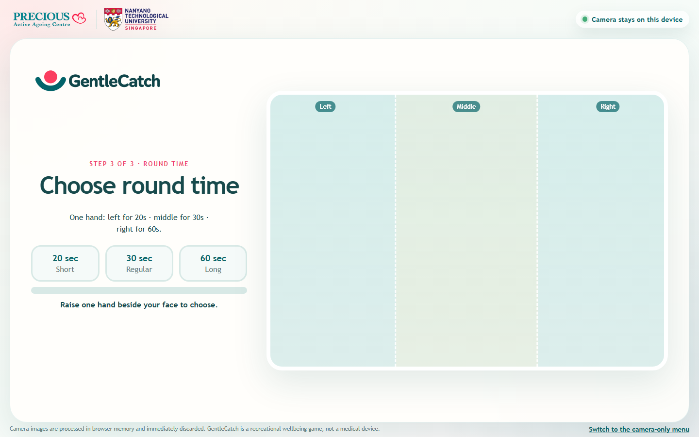
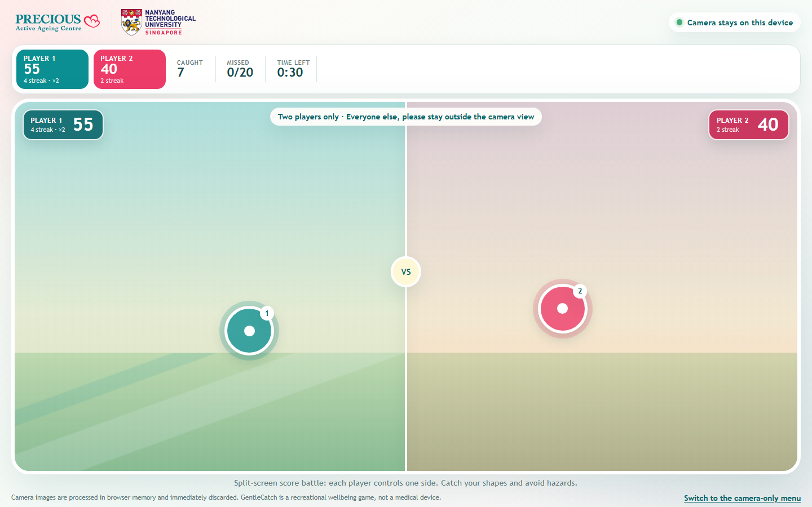

# GentleCatch

GentleCatch is a browser-based movement game designed for Precious Active Ageing Centre. Players move their hands to catch falling garden shapes and avoid hazards. It supports a camera-only kiosk flow for older adults, a staff-operated classic setup screen, solo play, and a local two-player split-screen score battle.

**[Play the deployed game](https://tech4good-gentlecatch.vercel.app/)** · **[Raspberry Pi kiosk guide](docs/raspberry-pi-kiosk.md)**



*Camera-only menu preview. The dotted regions show where to hold a hand relative to a face; no camera image or person is included in this screenshot.*



*Two-player gameplay preview with sample scores and cursors. A live session shows the camera behind the game; this documentation image does not capture a player.*

## What you can play

| Mode | Setup and controls | What happens |
| --- | --- | --- |
| **Camera-only kiosk** (default `/`) | Hands choose player count, pace and time. No mouse is needed after the first camera-permission setup. | Eight-second safety notice → three gesture choices → face-and-hand registration → three-second countdown → game → results → automatic return to the gesture menu. |
| **Classic menu** (`/?mode=manual`) | A staff member uses mouse or keyboard to choose settings. Camera-controlled play still uses tracked hands. | Offers the same solo and two-player game, plus a clearly labelled pose-first PvP tracker **beta** for comparison. |
| **Keyboard practice** (classic menu, solo only) | Choose **Try solo with keyboard**, then use arrow keys or W/A/S/D. | Lets someone try the game without granting camera access. Space or Escape pauses during keyboard play. |

The camera-only kiosk uses the palm tracker for **both** solo and two-player play. The optional pose-first beta is available only from the classic menu; it is not the default kiosk path.

### Camera-only session, step by step

1. The opening notice stays on screen for **at least eight seconds** while the camera and local tracking models start. Only players should remain in camera view.
2. At **Players**, one person raises one hand for Solo; two people stand or sit side by side and each raise one hand for Together. Hold the detected choice until the progress bar fills.
3. At **Difficulty** and **Round time**, either player holds **one** raised hand left, middle or right of their own face. Lower hands briefly between choices so a previous gesture does not select the next screen. The settings are Gentle / Steady / Lively and 20 / 30 / 60 seconds.
4. Registration checks the expected number of visible faces, associates a nearby hand with each player, and waits for stable detections. The face and hand positions lock when the **three-second countdown** begins; brief detector reordering cannot restart it.
5. During play, the palm position drives a circular cursor. In Together mode, Player 1 stays left and Player 2 stays right. Each side receives the same object type and starting position within its lane, with separate scores and streaks.
6. Results stay visible for **eight seconds**, then the kiosk returns to the camera menu. Players must lower their hands before making the next choice. A healthy camera stream and tracker are reused instead of being reloaded.

The menu needs a valid face–hand pairing and an uninterrupted hold of about **1.2 seconds**. Difficulty and round time use the **same** tracker and thresholds. A missed frame can currently reset a choice's progress; this is a known usability limitation, especially on slower hardware.

## Game rules

- Catch **leaves, flowers, hearts and stars** for 10, 15, 20 and 25 points respectively. Every three consecutive catches raises the multiplier by one, up to **×4**.
- Avoid **bombs and germs**. They deduct 25 and 15 points respectively (never below zero) and reset the streak.
- A missed collectible increases the missed count; missed hazards do not. The round ends when its time expires or the pace's miss limit is reached. In two-player play, the shared miss limit is doubled.
- Gentle, Steady and Lively increase falling speed, spawn frequency and on-screen object count while reducing the allowed misses. Players can choose a comfortable pace; seated and standing play are both welcome.
- Two-player mode is a **local split-screen score battle**, not network multiplayer. Each player collects objects only in their own half. The higher score wins; ties are possible.

## Tracking: models, APIs and safeguards

There is **no cloud vision API**. The app uses browser camera access (`getUserMedia`) and runs model inference on the device. Model files and WebAssembly assets are bundled under [`public/models`](public/models) and [`public/wasm`](public/wasm).

| Path | Technology | Use |
| --- | --- | --- |
| Default kiosk and normal classic camera play | [MediaPipe Tasks Vision](https://ai.google.dev/edge/mediapipe/solutions/vision/hand_landmarker/web_js) **Hand Landmarker** plus **Face Detector** | Palm landmarks control the cursor. Face detection supports menu choices, player registration and classic-menu re-entry checks. Tracking runs in a Web Worker; it tries GPU for hands, then falls back to CPU. |
| Optional classic-menu PvP beta | [TensorFlow.js MoveNet MultiPose](https://github.com/tensorflow/tfjs-models/tree/master/pose-detection) on WebGL | Associates a pose's nose, torso and wrist for each player. It is a comparison path and may be slower or unavailable on a Raspberry Pi. |

When several people appear during setup, the palm path estimates proximity from face-box size and considers only the largest face for Solo or the two largest separated faces for Together. The pose-first beta uses apparent shoulder span instead. Once chosen in the kiosk menu, those face slots are retained through the remaining choices and registration; hands closer to an ignored face are rejected. These are **2-D estimates, not true depth measurements**.

The face check is **positional tracking, not facial recognition or biometric identity verification**. It does not know whether a returning person is the same individual. In the kiosk, a player missing for roughly 1.8 seconds ends the round rather than allowing a new person to inherit their controls. In the classic menu, the game can pause for positional re-entry checks; the pose-first beta additionally asks for manual same-player confirmation. Normal palm-tracked gameplay turns face detection off to save work, so an extra person cannot be reliably detected or locked out throughout a round. Keep bystanders outside the camera view.

For performance, the kiosk requests approximately **640 × 360** camera frames, downsamples hand inference to **384 × 216**, and caps palm inference at **30 FPS**. Face checks run at most **8 FPS** during setup and recovery. The game loop is capped at 30 updates per second, and inference frames are not queued while the worker is busy. These are **ceilings, not guaranteed frame rates**. Real FPS depends on browser, lighting, camera, thermals and hardware.

Camera frames are processed in browser memory and are not uploaded or saved by the app. GentleCatch is a recreational wellbeing game, **not** a medical device, fall detector or rehabilitation assessment.

## Run locally

Use Node.js **20.19+ or 22.12+** and a current browser. From this repository:

```bash
npm ci
npm run dev
```

Open `http://127.0.0.1:5173/` for the camera-only kiosk or `http://127.0.0.1:5173/?mode=manual` for the classic menu. Allow camera permission when prompted. Browser camera access requires a secure context; localhost/loopback works for local testing, while a remote site should use HTTPS.

```bash
npm test          # unit tests
npm run build     # static production files in dist/
npm run preview   # locally serve the production build
```

The `?preview=...` routes used to make the screenshots above are development-only and do not start a real camera session.

## Deploy on a Raspberry Pi

**Pi 5 is preferred**, particularly for two-player play. A Pi 4 may struggle with sustained tracking; neither board has been release-validated for this project yet. Test the complete session on the actual board before using it with participants.

1. Install **Raspberry Pi OS 64-bit with Desktop**, a suitable power supply, Chromium, and a UVC-compatible webcam. Use a current Node.js version meeting the requirement above if building on the Pi.
2. Clone this branch on the Pi and build it, or build on another computer and copy the resulting `dist/` directory to the Pi:

   ```bash
   git clone --branch v9-final-debugging-edits https://github.com/AlbieTan/Tech4Good-GentleCatch.git
   cd Tech4Good-GentleCatch
   npm ci
   npm run build
   python3 -m http.server 8000 --bind 127.0.0.1 --directory dist
   ```

3. In a persistent Chromium profile, visit `http://127.0.0.1:8000/` and **allow camera access once with staff present**. Then test a full solo and two-player session.
4. Configure the static server to start before Chromium and to restart on failure. Launch Chromium in kiosk mode at the same loopback URL. Follow the [official Raspberry Pi kiosk tutorial](https://www.raspberrypi.com/tutorials/how-to-use-a-raspberry-pi-in-kiosk-mode/) for the installed desktop's autostart method. Our [Pi-specific guide](docs/raspberry-pi-kiosk.md) has an installation outline and safety checks.
5. Cold-reboot the Pi and verify that the browser opens, camera permission persists, the menu works without a mouse, both players remain tracked, and results return to the menu.

Do not use a browser flag that silently grants camera access to every site. Keep a staff-accessible way to exit kiosk mode or stop the Pi; the game UI is not an emergency stop.

### Before a real session

| Check | Why it matters |
| --- | --- |
| Even light on faces and hands; camera near display height | Low light, blur and backlighting reduce detections. |
| Both players fully in view, on separate sides, with space between them | Crossed arms, overlapping faces and hands, or a third person can make ownership ambiguous. |
| Hands visible beside (not covering) faces during setup | The menu and registration deliberately reject uncertain face–hand pairings. |
| Watch actual palm FPS and responsiveness for a full 60-second PvP round | A successful startup alone does not establish Pi performance. |
| Test loss of camera, player leaving frame, round end and reboot recovery | Kiosk operation must recover safely without a mouse. |
| Offer seated play and a staff-assisted alternative | Players should stop if movement is uncomfortable or tracking becomes frustrating. |

## Known limitations and troubleshooting

- **Selection bar not filling:** lower all hands briefly after the previous choice, then show only one hand beside a visible face. Keep the hand in one zone. A detection dropout currently resets the 1.2-second hold.
- **Tracking lags:** improve light, avoid backlighting, close other tabs and camera apps, and check the on-screen tracker FPS/inference time. The Pi 5 is the recommended starting point for PvP; Pi 4 PvP is unverified.
- **Two players swap or cannot register:** stand farther apart, keep hands on your own sides, avoid crossing the middle, and keep bystanders out of view. The app uses position, not biometric identity.
- **No camera:** confirm the browser has permission for the exact localhost origin, the webcam is connected and unused by another app, and Chromium is running on the Pi desktop.
- **Browser works on desktop but not Pi:** confirm a 64-bit OS, current Chromium, local model/WASM files in `dist/`, sufficient power and cooling, and that the static server is reachable before Chromium launches.

## Credits

Built on [Hakrrrm's initial Tech4Good prototype](https://github.com/Hakrrrm/tech4good). [AlbieTan](https://github.com/AlbieTan) developed the later UI, kiosk and two-player versions. Precious Active Ageing Centre and NTU branding appears in the game. See [third-party notices](THIRD_PARTY_NOTICES.md) for model and library attribution.
